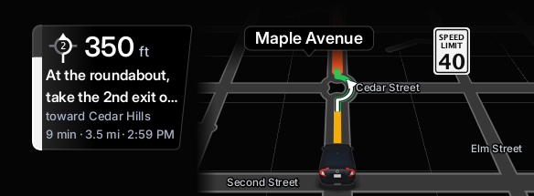

# Honda head-unit dash map from openpilot

A 10th-gen Honda Civic (2016-2021, Mitsubishi Electric ADA head unit, Android 4.2.2) shows a
live map on the instrument cluster. The map is drawn by an Xposed module on the head unit and
fed by the comma device running openpilot. It shows:

- the route carpet in openpilot's mode colour;
- road tiles with bridges, ramps, lanes and traffic signals;
- a 3D close-up near turns;
- the car sprite with brake lights, turn signals and a red blind-spot halo;
- now-playing info and a trip line;
- slow traffic (Mapbox Traffic: moderate, heavy, severe) coloured on the roads, with or without a route;
- roundabouts and U-turns: an exit-numbered roundabout icon and "Make a U-turn" on the turn card, and a
  white maneuver arrow on the map.

This branch holds only that feature, taken from a working openpilot fork
(`trung791997/openpilot`, commit `5044693486`; first extracted at `f5738be617`). It is meant to be read by a person or an LLM porting
the feature into another fork. File paths match the source fork, so they map one to one.

**Status.** It runs on one car. Most of the code has static and desktop tests only. The comments
record what was seen on the car and what was not. It is not a drop-in package: the comma side
depends on modules from the source fork (see "Comma side").

## Demo

Rendered on a desktop JVM by the app's own drawing code (the software canvas path, with Java2D
stand-ins for the Android classes) against a synthetic street grid. `tools/head_unit/aaroad/desktop/`
has the harness; `desktop/render.sh` rebuilds these. Fonts and anti-aliasing differ slightly from
the car.

| | |
|---|---|
| Navigation with music playing |  |
| Navigation, no music |  |
| Music, no navigation (traffic shown) |  |
| No music, no navigation |  |
| U-turn |  |

## Requirements

- **Head unit:** Honda Hack (`cn.autohack.hondahack`) installed, with its Xposed bridge and its
  custom Civic meter page. The module installs as package `cn.autohack.coolui`, because Honda Hack's
  bridge only loads modules from its own and CoolUI's apk slots. CoolUI itself must not be installed.
- **Transport:** two paths, chosen at run time.
  - **Android Auto channel 13 (preferred).** While the comma is projecting Android Auto, the feed rides
    inside the AA session itself, on the vendor-extension service (service 12, channel 13). The head
    unit's `VendorTunnel.java` receives it. No shared Wi-Fi is needed, and the comma's wlan0 is not
    loaded with 20 Hz UDP while aa0 streams video.
  - **UDP over a shared Wi-Fi (fallback).** With no AA session, or a head-unit apk without
    `VendorTunnel`, the comma and head unit must be on the same Wi-Fi, normally a phone hotspot (the head
    unit's Wi-Fi is 2.4 GHz only).
  - The channel-13 path needs **both halves**: the comma-side sender in `starport/session.py` (included,
    with the whole `starport/` package; its outside-starport deps are listed in "Missing components") and a head-unit apk built from this branch. An old apk or an
    unpatched comma leaves only UDP.
- **Comma:** openpilot with the feed server below, and Mapbox access on the comma for road tiles
  and routes. The token stays on the comma; nothing secret is built into the head-unit app.

## Head-unit side: `tools/head_unit/aaroad/`

An Xposed module written in plain Java, with no Gradle. `tools/head_unit/aaroad/README.md` has the
full details.

**Build your own apk.** No apk is published; build it yourself (about a minute). You need a JDK (17 works),
`python3`, the Android SDK command-line tools, and the Xposed API jar.

```bash
# 1. Android SDK: build-tools 34.0.0 and the API 17 platform (sdkmanager is in Android's command-line tools)
export SDK=$HOME/android-sdk
sdkmanager --sdk_root=$SDK "build-tools;34.0.0" "platforms;android-17"

# 2. Xposed API 82 (compile-only; the device's Xposed provides it at runtime)
export XPOSED_JAR=$HOME/api-82.jar
curl -L -o $XPOSED_JAR https://api.xposed.info/de/robv/android/xposed/api/82/api-82.jar

# 3. Build: writes tools/head_unit/aaroad/out/aaroad.apk
tools/head_unit/aaroad/build.sh
```

`build.sh` puts build-tools on `PATH` itself (`aapt`, `d8`, `zipalign`, `apksigner`); `javac` and `keytool` come
from your JDK. Without `SDK` / `XPOSED_JAR` set it looks in `/tmp/hu/sdk` and `/tmp/hu/api-82.jar`. The turn-card
arrows are copied in from `openpilot/starpilot/ui/assets/navigation/` (included on this branch; set `NAV=` to use
your own).

The first build makes `tools/head_unit/aaroad/debug.keystore` (git-ignored). Keep it: Android refuses an update
signed with a different key, so losing it means uninstalling before the next install. An apk someone else built
is signed with their key, so switching between builds also needs an uninstall first.

**Install.** Run `adb install` on the apk, then reboot the head unit (Xposed modules load in zygote).
To uninstall, run `pm uninstall cn.autohack.coolui`, then reboot.

**Code layout** (`src/com/starpilot/aaroad/`):

- `Hook.java` is the entry point. It hooks the Mitsubishi Android Auto app.
- `Meter.java` and `Panel.java` add the map into Honda Hack's meter page.
- `Feed.java` receives the comma feed (UDP, or frames handed over by `VendorTunnel`).
- `VendorTunnel.java` binds to the Mitsubishi AA app's raw vendor channel (13) in the main androidauto
  process only (not `:logoutprocess`), strips the 2-byte `SP` (0x5350) prefix and passes each JSON
  datagram to `Feed`. `Hook.java` installs it.
- `Relay.java` runs in Honda Hack's process. When the meter process may not open sockets, it bridges
  the feed over the local socket `aaroad.feed`, framed as a u16 length followed by the datagram.
- The map and its GLES2 layers are `MapView`, `GlRoads`, `CloseUp`, `CloseView`, `Gl3d`, `GlCull`
  and `GlClose`.
- Each of `Lanes`, `Signals`, `Shield`, `Snap`, `Under`, `Blink`, `SignalIcon`, `Turn` and `NavArrow`
  draws one feature.
- Logs go to `/data/data/cn.autohack.hondahack/log/error.log` (needs su).

**Other files.**

- `test/*.java` holds plain-Java tests against stub Android classes. `MapReplayBench` needs a bench
  harness that is not included.
- `tools/head_unit/civic/civic3d.py` generates the car sprite (`assets/civic_map.png`).

## Comma side

**The feed server.** It is `openpilot/starpilot/system/starport/hu_feed.py` (`HeadUnitFeed`), and its
docstring is the protocol reference. It has no process of its own. In the source fork the Android
Auto daemon `starportd` starts it on comma hardware and hands it to the AA supervisor
(`starport/daemon.py` lines 258-266, at `5044693486`):

```python
from openpilot.starpilot.system.starport.hu_feed import HeadUnitFeed
hu_feed = HeadUnitFeed(log=lambda event, **fields: print(json.dumps({"event": event, **fields}), flush=True)).start()
supervisor.hu_feed = hu_feed
cleanup.callback(hu_feed.close)
```

For UDP only, start `HeadUnitFeed` from any long-running process and call `close()` on exit. For
channel 13 you also need the AA session wiring below.

**Channel-13 sender (AA session wiring).** `hu_feed.py` exposes `attach_aa()`, `detach_aa()`,
`receive_aa(data)` and `drain_aa(limit)`; while a head unit answers over the tunnel, `aa_active()` is true
and frames are queued for AA instead of sent over UDP (nav/state/pose first, tiles rate-limited). The
AA side is included here, copied unchanged from `5044693486`:

- `starport/session.py`: `VENDOR_EXTENSION_SERVICE = 12`, `VENDOR_TUNNEL_KIND = 0x5350`,
  `VENDOR_TUNNEL_BURST = 8`. When the head unit's service discovery lists the vendor extension service,
  the session opens that channel (`vendor_channel`) and calls `hu_feed.attach_aa()`. `service_vendor()`
  sends `hu_feed.drain_aa(8)` frames as kind 0x5350 on it; incoming 0x5350 frames go to
  `hu_feed.receive_aa()`.
- `starport/supervisor.py`: holds `hu_feed`, gives it to each new session, calls `service_vendor()` in the
  session loop, and `detach_aa()` when the session ends or the tunnel throws.
- `starport/daemon.py`: `supervisor.hu_feed = hu_feed` (above).
- Source commits: `1eddcb9646` (tunnel), `1353173b6b` (main-process bind on the head unit), `95233e3757`
  (nav/state/pose ahead of tile chunks). Read them with
  `git show <commit> -- openpilot/starpilot/system/starport/{session,supervisor,daemon}.py`.

**Wi-Fi during projection.** `5044693486` also changes `starport/network.py` (not on this branch) so the
comma yields wlan0 while aa0 projects and turns off AA Wi-Fi power save; `wifi_rejoin.py` (included)
honours that. Without it the map still works, but wlan0 and aa0 contend for the radio.

**Traffic.** `openpilot/starpilot/navigation/traffic_tiles.py` fetches Mapbox Traffic v1 tiles
(zoom 14, 3x3 around the car, every 5 minutes at most) with the comma's Mapbox token, keeps only the
moderate, heavy and severe roads, and packs them into a small `SPTQ` payload. `hu_feed.py` sends
them as `q` messages to head units that say `"tq":1` in their hello. It imports `road_tiles.py` from
the source fork. The head unit drops traffic older than 15 minutes.

**Hotspot rejoin.** `starport/wifi_rejoin.py` keeps the comma on the phone hotspot that the feed uses.
It needs `starport/scan_quiet.py` (included) and `DATA_DIR` and `boot_id` from `starport/identity.py`
(not included).

## Missing components

**Included from `5044693486`** (copied unchanged): the whole `starportd` package,
`openpilot/starpilot/system/starport/` — every module (`daemon.py`, `supervisor.py`, `session.py`, `hu_feed.py`,
`wire.py`, `touch.py`, `nav_status.py`, `identity.py`, the Bluetooth/USB/network/projection/encoder modules and the
rest), its `SConscript`, `LICENSE`, and `hw/` (the encoder source `starport_encoder.cc` / `rgba_to_nv12.h`, its test,
and the prebuilt `libstarport_encoder.so`, which is **aarch64** — rebuild it with the `SConscript` for any other
target; the `SConscript` is not wired into a build on this branch). Only Python syntax was checked; nothing was run.

**Also included from `5044693486`** (copied unchanged, 58 files): every fork `starpilot/` module that the
`starport/` package imports directly — `aol/runtime`, `bluetooth/owner`, `conditional_mode/policy`,
`drive_state/{evidence,owner}`, `galaxy/{evidence,hotspot_netlink,settings,spotify_setup}`, `gps/{head_unit,source}`,
`models/jetlink_status`, `navigation/{guidance_hold,offline_roads,owner,road_tiles,wire}`, `saved_source`,
`soloist/{backend,now_playing,paths}`, `speed_limits/vision/observation`, `spot_monitor/preferences`,
`system/pipe_worker`, and the projected-UI modules in `starpilot/ui/` (`appearance_preferences`,
`large_speed_geometry`, `navigation_favorites_state`, `navigation_icons`, `onroad*`, `pip_*`, `presentation`,
`radar_points`, `raylib`, `runtime_snapshot`, `shell`, `unified_speed_presentation`), with their package `__init__.py`.

**Still not on this branch.** `starportd` will not import until each exists or is replaced. Following imports past
the first level reaches ~480 fork files (car, lateral, longitudinal and flm control code included), so the rest is
listed, not copied — check out `5044693486` (bob-unify-car) for the full tree. A port that has its own AA stack only
needs the hu_feed hooks in `session.py` / `supervisor.py` described above.

- stock openpilot: `cereal` (`messaging`, `services`, `visionipc`), `msgq.visionipc`,
  `common/{params,basedir,constants,hardware,swaglog,utils,version}`, `common/transformations/camera`,
  `opendbc.car`, `system/ui/lib/application`, `tools/replay`, and
  `selfdrive/ui/{ui_state,onroad/augmented_road_view,onroad/cameraview,onroad/model_renderer}` (the projected
  onroad view);
- fork `starpilot/` modules imported by the 58 files above (second level), about 90, mostly more `starpilot/ui/`
  (`onroad_*` widgets, `*_owner`, `*_state`, `settings`, `toggles`, `home`, `pip_shaders`, ...), plus
  `aol/{panda_faults,vehicle,wire}`, `conditional_mode/{manual,projection,runtime_settings,status}`,
  `controllers/{mode_actions,toyota_cruise}`, `drive_state/resolver`, `galaxy/{access,developer_settings,
  localization_settings,setting_descriptions,vehicle_configuration}`, `gps/acquisition`, `lateral/lane_runtime`,
  `longitudinal/profile_runtime`, `maps/storage`, `speed_limits/{acceptance,toyota,vision_gate}`,
  `spot_monitor/{observation,policy}`, `replay/render`, `audio/alert_volume`, `bluetooth/radio_preference`,
  `curve_speed/status`, `feature_capabilities`, `local_timezone`, `parked_evidence`, `schema_cache`, `storage`;
- libraries: `cv2`, numpy, PIL, `capnp`, `jeepney`, `raylib_nb`, `websocket`.

**Modules `hu_feed.py` imports from the source fork:**

- navigation: `openpilot/starpilot/navigation/{offline_roads,road_tiles,guidance_hold,wire,traffic_tiles}.py`.
  The tiles come from `navigation/navtilesd.py`, which reads the Mapbox token from the comma's settings.
- GPS and lateral state: `gps/source.py` and `aol/runtime.py`.
- `opendbc.car.structs` (`car`), plus `openpilot.cereal.messaging` and `openpilot.common.params` from stock
  openpilot; `PIL` for album art.
- other UI state:
  - `ui/pip_warning.py` (blind-spot camera);
  - `spot_monitor/preferences.py`;
  - `speed_limits/vision/observation.py`;
  - `soloist/now_playing.py` and `soloist/paths.py`.

Read them at https://github.com/trung791997/openpilot/tree/5044693486/openpilot/starpilot.

**cereal services it reads:**

- stock openpilot: `selfdriveState`, `carControl`, `carState`, `deviceMotion`, `gpsLocationExternal`,
  `gpsLocation`;
- fork-only: `aolAxisState`, `starpilotNavigation`, `starpilotCarState`, `slcState`.

Replace the fork-only ones with what your fork has. The head unit needs only the fields in the
protocol below.

**Tests** (in `starport/tests/`):

- `test_hu_feed.py`;
- `test_dash_turn_card.py`, which compiles `Turn.java` and so needs `java`;
- `test_wifi_rejoin.py`;
- `test_vendor_extension_probe.py` (channel-13 session wiring; needs `session.py`, `wire.py`, `touch.py`, `nav_status.py`, all included, plus their outside-starport deps);
- and, outside `starport/`, `openpilot/starpilot/navigation/tests/test_traffic_tiles.py`.

These tests run in the full source fork. On this branch alone some of them fail or do not load,
because they import fork modules that are not on this branch.

## Protocol

The same JSON messages travel on either transport:

- **AA channel 13:** each message is one AA frame on the vendor-extension channel, payload =
  `SP` (0x53 0x50) + the JSON bytes. The head unit's hello comes back the same way.
- **UDP port 47312:** each datagram is one JSON object, under 1472 bytes.

Every message carries `v` (version) and `t` (kind).

| kind `t` | direction, rate | body |
|---|---|---|
| `b` beacon | comma broadcasts, 1 Hz, on every interface except `lo` and `aa*` | `port` |
| `h` hello | head unit to comma, about 1 Hz | `have`: tiles held; `rt`: newest tile format it reads |
| `s` state | 1 Hz and on change | `mode`, `metric`, `nav`, `limit`, `media`, `pos` |
| `r` route | on change, and every few seconds | `id`, `i`, `n`, `pts` (`[lat, lon]` list), optional `c` traffic per point |
| `p` pose | 20 Hz | `lat`, `lon`, `hdg`, `spd`, `age`, `b` brake, `bl`/`br` blind spot, `tl`/`tr` turn signals, `held` |
| `m` road tile | 3x3 tiles around the car, nearest first | `k` `"x/y"` (zoom 14), `i`, `n`, `b` base64 piece |
| `a` album cover | on change | `id`, `i`, `n`, `b` base64 piece of a JPEG |

The comma:

- unicasts only to the source of the latest hello;
- answers only private addresses;
- serves one head unit at a time;
- stops 5 s after the hellos stop;
- prefers the AA tunnel while a hello arrives on it, and falls back to UDP when it stops.

`hu_feed.py`'s docstring and `tools/head_unit/aaroad/README.md` define every field.
