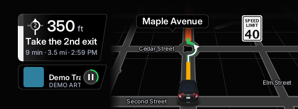
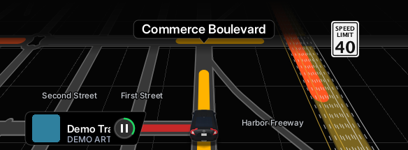
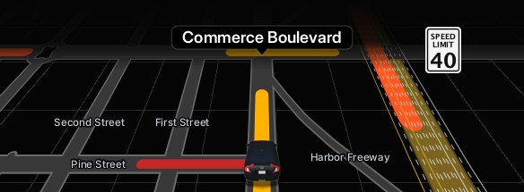
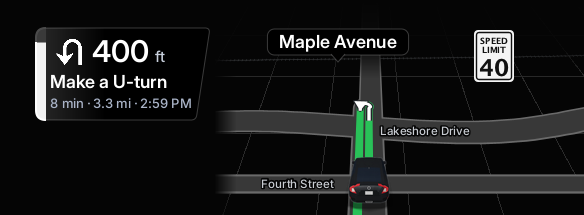

# Honda head-unit dash map from openpilot

A 10th-gen Honda Civic (2016-2021, Mitsubishi Electric ADA head unit, Android 4.2.2) shows a
live map on the instrument cluster. The map is drawn by an Xposed module on the head unit and
fed by the comma device running openpilot. It shows:

- the route carpet in openpilot's mode colour;
- road tiles with bridges, ramps, lanes and traffic signals;
- a 3D close-up near turns;
- the car sprite with brake lights, turn signals and a red blind-spot halo;
- now-playing info and a trip line;
- slow traffic (Mapbox Traffic: moderate, heavy, severe) coloured on the roads, with or without a route;
- roundabouts and U-turns: an exit-numbered roundabout icon and "Make a U-turn" on the turn card, and a
  white maneuver arrow on the map.

This branch holds only that feature, taken from a working openpilot fork
(`trung791997/openpilot`, commit `f5738be617`). It is meant to be read by a person or an LLM porting
the feature into another fork. File paths match the source fork, so they map one to one.

**Status.** It runs on one car. Most of the code has static and desktop tests only. The comments
record what was seen on the car and what was not. It is not a drop-in package: the comma side
depends on modules from the source fork (see "Comma side").

## Demo

Rendered on a desktop JVM by the app's own drawing code (the software canvas path, with Java2D
stand-ins for the Android classes) against a synthetic street grid. `tools/head_unit/aaroad/desktop/`
has the harness; `desktop/render.sh` rebuilds these. Fonts and anti-aliasing differ slightly from
the car.

| | |
|---|---|
| Navigation with music playing |  |
| Navigation, no music |  |
| Music, no navigation (traffic shown) |  |
| No music, no navigation |  |
| U-turn |  |

## Requirements

- **Head unit:** Honda Hack (`cn.autohack.hondahack`) installed, with its Xposed bridge and its
  custom Civic meter page. The module installs as package `cn.autohack.coolui`, because Honda Hack's
  bridge only loads modules from its own and CoolUI's apk slots. CoolUI itself must not be installed.
- **Network:** the comma and the head unit on the same Wi-Fi, normally a phone hotspot. The head
  unit's Wi-Fi is 2.4 GHz only. A wireless Android Auto dongle's link does not carry IP to the head
  unit, so the feed cannot use it.
- **Comma:** openpilot with the feed server below, and Mapbox access on the comma for road tiles
  and routes. The token stays on the comma; nothing secret is built into the head-unit app.

## Head-unit side: `tools/head_unit/aaroad/`

An Xposed module written in plain Java, with no Gradle. `tools/head_unit/aaroad/README.md` has the
full details.

**Build.** Run `build.sh`. It needs:

- Android SDK build-tools 34.0.0 and the `platforms;android-17` `android.jar`, both under `/tmp/hu/sdk`;
- the Xposed API jar at `/tmp/hu/api-82.jar` (not included);
- `javac`, `d8`, `aapt`, `zipalign`, `apksigner` and `keytool`.

`build.sh` makes a local debug keystore; no keystore is committed. It also copies
`openpilot/starpilot/ui/navigation-assets.json` and `openpilot/starpilot/ui/assets/navigation/*` from
the source fork; these are the turn-arrow icons, and this branch does not include them. Take them
from the source fork, or point `build.sh` at your own.

**Install.** Run `adb install` on the apk, then reboot the head unit (Xposed modules load in zygote).
To uninstall, run `pm uninstall cn.autohack.coolui`, then reboot.

**Code layout** (`src/com/starpilot/aaroad/`):

- `Hook.java` is the entry point. It hooks the Mitsubishi Android Auto app.
- `Meter.java` and `Panel.java` add the map into Honda Hack's meter page.
- `Feed.java` receives the comma feed.
- `Relay.java` runs in Honda Hack's process. When the meter process may not open sockets, it bridges
  the feed over the local socket `aaroad.feed`, framed as a u16 length followed by the datagram.
- The map and its GLES2 layers are `MapView`, `GlRoads`, `CloseUp`, `CloseView`, `Gl3d`, `GlCull`
  and `GlClose`.
- Each of `Lanes`, `Signals`, `Shield`, `Snap`, `Under`, `Blink`, `SignalIcon`, `Turn` and `NavArrow`
  draws one feature.
- Logs go to `/data/data/cn.autohack.hondahack/log/error.log` (needs su).

**Other files.**

- `test/*.java` holds plain-Java tests against stub Android classes. `MapReplayBench` needs a bench
  harness that is not included.
- `tools/head_unit/civic/civic3d.py` generates the car sprite (`assets/civic_map.png`).

## Comma side

**The feed server.** It is `openpilot/starpilot/system/starport/hu_feed.py` (`HeadUnitFeed`), and its
docstring is the protocol reference. It has no process of its own. In the source fork the Android
Auto daemon `starportd` starts it on comma hardware (`starport/daemon.py` lines 258-266, at
`f5738be617`):

```python
from openpilot.starpilot.system.starport.hu_feed import HeadUnitFeed
hu_feed = HeadUnitFeed(log=lambda event, **fields: print(json.dumps({"event": event, **fields}), flush=True)).start()
cleanup.callback(hu_feed.close)
```

To port it, start `HeadUnitFeed` from any long-running process and call `close()` on exit.

**Traffic.** `openpilot/starpilot/navigation/traffic_tiles.py` fetches Mapbox Traffic v1 tiles
(zoom 14, 3x3 around the car, every 5 minutes at most) with the comma's Mapbox token, keeps only the
moderate, heavy and severe roads, and packs them into a small `SPTQ` payload. `hu_feed.py` sends
them as `q` messages to head units that say `"tq":1` in their hello. It imports `road_tiles.py` from
the source fork. The head unit drops traffic older than 15 minutes.

**Hotspot rejoin.** `starport/wifi_rejoin.py` keeps the comma on the phone hotspot that the feed uses.
It needs `starport/scan_quiet.py` (included) and `DATA_DIR` and `boot_id` from `starport/identity.py`
(not included).

**Modules `hu_feed.py` imports from the source fork** (not on this branch):

- navigation: `openpilot/starpilot/navigation/{offline_roads,road_tiles,guidance_hold,wire}.py`.
  The tiles come from `navigation/navtilesd.py`, which reads the Mapbox token from the comma's settings.
- GPS and lateral state: `gps/source.py` and `aol/runtime.py`.
- other UI state:
  - `ui/pip_warning.py` (blind-spot camera);
  - `spot_monitor/preferences.py`;
  - `speed_limits/vision/observation.py`;
  - `soloist/now_playing.py` and `soloist/paths.py`.

Read them at https://github.com/trung791997/openpilot/tree/f5738be617/openpilot/starpilot.

**cereal services it reads:**

- stock openpilot: `selfdriveState`, `carControl`, `carState`, `deviceMotion`, `gpsLocationExternal`,
  `gpsLocation`;
- fork-only: `aolAxisState`, `starpilotNavigation`, `starpilotCarState`, `slcState`.

Replace the fork-only ones with what your fork has. The head unit needs only the fields in the
protocol below.

**Tests** (in `starport/tests/`):

- `test_hu_feed.py`;
- `test_dash_turn_card.py`, which compiles `Turn.java` and so needs `java`;
- `test_wifi_rejoin.py`;
- and, outside `starport/`, `openpilot/starpilot/navigation/tests/test_traffic_tiles.py`.

These tests run in the full source fork. On this branch alone some of them fail or do not load,
because they import fork modules that are not on this branch.

## Protocol

UDP port 47312. Each datagram is one JSON object, under 1472 bytes. Every message carries `v`
(version) and `t` (kind).

| kind `t` | direction, rate | body |
|---|---|---|
| `b` beacon | comma broadcasts, 1 Hz, on every interface except `lo` and `aa*` | `port` |
| `h` hello | head unit to comma, about 1 Hz | `have`: tiles held; `rt`: newest tile format it reads |
| `s` state | 1 Hz and on change | `mode`, `metric`, `nav`, `limit`, `media`, `pos` |
| `r` route | on change, and every few seconds | `id`, `i`, `n`, `pts` (`[lat, lon]` list), optional `c` traffic per point |
| `p` pose | 20 Hz | `lat`, `lon`, `hdg`, `spd`, `age`, `b` brake, `bl`/`br` blind spot, `tl`/`tr` turn signals, `held` |
| `m` road tile | 3x3 tiles around the car, nearest first | `k` `"x/y"` (zoom 14), `i`, `n`, `b` base64 piece |
| `a` album cover | on change | `id`, `i`, `n`, `b` base64 piece of a JPEG |

The comma:

- unicasts only to the source of the latest hello;
- answers only private addresses;
- serves one head unit at a time;
- stops 5 s after the hellos stop.

`hu_feed.py`'s docstring and `tools/head_unit/aaroad/README.md` define every field.
